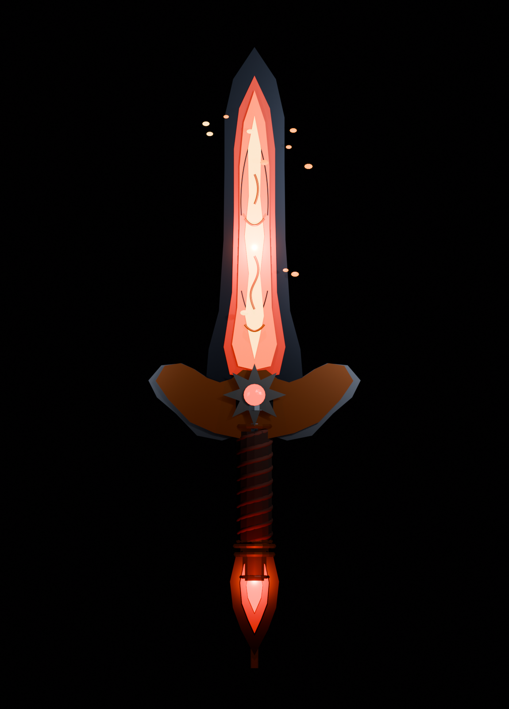

# AssetForge

AssetForge is a standalone, agent-friendly toolkit for producing, validating and packaging game assets. It provides a Python CLI, versioned JSON contracts and optional adapters for Blender, blender-skills, glTF-Transform, the Khronos glTF Validator, comfy-kit, img2threejs, teardown and local audio models (voice lines and sound effects).

It is designed to work on its own and can also be registered as a companion of the Ultimate AI Starter Bundle. The bundle is recommended, never required.

AssetForge orchestrates other owners. It does not fork Blender, ComfyUI, Graphite, img2threejs or any other upstream application.

## Start with `probe`

```bat
assetforge.cmd probe path\to\model.fbx
assetforge.cmd probe path\to\folder
```

`probe` needs no project and writes nothing. It reports what the file is (triangles, texture sizes, rig, animations, which export budgets it fits) and prints the recipe command to run next. A mesh that is not a GLB goes through `mesh-convert` first.

## Game-ready mesh (one command)

A generated GLB at sculpt density does not ship. About 700,000 triangles fails. The default budget `game` hard-fails above **20,000 triangles** and shrinks textures to **1024**. Ask for `hero` (30,000) only for a close-up that is not a Roblox mesh, or `accessory` (4,000) for a worn Roblox accessory.

```bat
assetforge.cmd run mesh-gameready --input mesh=model.glb
```

Rules: [docs/GAME-READY.md](docs/GAME-READY.md).

## Voice lines and sound effects

```bat
assetforge.cmd audio-setup
assetforge.cmd run audio-voice --input lines=lines.txt --set "voice=a warm, slightly haughty young princess"
assetforge.cmd run audio-sfx --set "prompt=a steel sword swinging through the air" --set name=swing
assetforge.cmd export ASSET --target minecraft --namespace mymod
```

`audio-setup` installs three isolated local runtimes. Qwen3-TTS designs a voice from a description and clones it for every line, Dia speaks nonverbals such as `(laughs)` and `(gasps)`, Kokoro gives fast preset voices, and MOSS-SoundEffect v2 makes sound effects. All of them are Apache-2.0. Whisper checks the words of each take, CLAP checks each effect against its prompt, and the best take is trimmed, levelled to a loudness target and encoded. `audio-process` finishes audio you already have. Details: [docs/AUDIO.md](docs/AUDIO.md).

## Quick start (Windows)

1. Run `START-HERE.bat`. It creates a repo-local `.venv`, installs Pillow for the image recipes, and runs `doctor`.
2. Create or enter a project folder and run:

```bat
assetforge.cmd init .
assetforge.cmd recipes
assetforge.cmd providers
assetforge.cmd run image-prep --input path\to\source.png
```

The installer writes only inside the AssetForge folder. It does not install Blender, Node packages, ComfyUI or model weights.

## Quick start (Linux / macOS)

```bash
python3 -m venv .venv
source .venv/bin/activate
pip install -e ".[images]"
assetforge doctor
```

## Commands

```text
assetforge --version
assetforge doctor [--json]
assetforge capabilities [--json]
assetforge providers [--json]
assetforge blender-skills [--route NAME] [--json]
assetforge probe PATH [--json]
assetforge init [path] [--name NAME]
assetforge recipes [list | RECIPE] [--json]
assetforge run RECIPE [--input PATH | NAME=PATH] [--set KEY=VALUE] [--dry-run] [--json]
assetforge status [JOB_ID | --last] [--json]
assetforge inspect ASSET [--json]
assetforge validate ASSET [--json]
assetforge export ASSET --target roblox|godot|generic|minecraft [--namespace NS] [--dry-run] [--json]
assetforge audio-setup [speech|sfx|kokoro ...] [--list] [--device auto|cuda|cpu] [--json]
assetforge engine-check FILE.glb [--json]
```

Exit codes are stable: `0` success, `2` usage/recipe error, `3` missing project/asset/job, `4` provider unavailable, `5` validation or budget failure, `6` run failure.

## Recommended texture workflow (comfy-kit)

For free local texture generation, the recommended companion is **comfy-kit**. It owns the SwarmUI/ComfyUI installation, models, presets and MCP configuration; AssetForge only delegates a render and keeps the result inside the asset.

```bat
assetforge.cmd run comfy-generate --set "prompt=seamless weathered steel, top-down, tileable" --set width=1024 --set height=1024
assetforge.cmd run texture-pack --input occlusion=ao.png --input roughness=rough.png --input metallic=metal.png
assetforge.cmd export ASSET --target godot
```

`comfy-import` also accepts an existing comfy-kit output folder. If comfy-kit is not installed, `comfy-generate` exits with code `4` and a clear provider message; AssetForge never installs models or changes comfy-kit configuration.

## Recommended Blender workflow (blender-skills)

For Blender work, the recommended provider is [EL4CTEO/blender-skills](https://github.com/EL4CTEO/blender-skills), an MIT-licensed set of 28 agent skills for modeling, UVs, PBR, baking, rigging, animation, optimization, QA and export. AssetForge exposes all 28 and executes six of them through explicit, whitelisted operations: core runner, PBR materials, asset QA, export pipelines, mesh optimization (`mesh-stats`, `make-lods`) and retopology/UV (`auto-retopo`, `uv-pack`, `texel-density`). AssetForge does not vendor upstream; point `BLENDER_SKILLS_ROOT` at a checkout or installed skills folder, then inspect the catalog:

```bat
assetforge.cmd blender-skills --json
assetforge.cmd blender-skills --route materials
assetforge.cmd run blender-pipeline
assetforge.cmd run blender-optimize --input input.blend --set operation=mesh-stats --set budget=roblox
assetforge.cmd run blender-retopo-uv --input sculpt.blend --set operation=uv-pack
assetforge.cmd export ASSET --target godot
```

`blender-pipeline` builds a procedural crate, applies an upstream PBR preset, runs the **mandatory** `blender-asset-qa` gate, writes random/wire review sheets, exports GLB through upstream `blender-export-pipelines`, optimizes it and validates it. A QA error or unaccepted warning fails the job before delivery. Rendering the review sheets is not visual approval: `BLENDER-QA-VISUAL` stays `NOT_TESTED` until an explicit `--set visual_review=approved --set approval_note="..."` records the inspection. `blender-qa` applies the same gate to an existing `.blend`. `blender-optimize` and `blender-retopo-uv` expose the mesh-statistics, LOD generation, retopology, UV packing and texel-density scripts on an existing `.blend`; mutating operations write a new `.blend` artifact and leave the input untouched.

Blender 5.2+ is required. `BLENDER_EXE` selects the executable; detection also checks `PATH`, the Blender Foundation folders, the uninstall registry, every Steam library and a portable copy under a declared tool root. Blender MCP is optional and not required; every step runs headless.

Upstream was tested at v1.3.0 (revision `3e481ad1b8e301defced7369e4254022abe0821e`) with Blender 5.3.0; v1.2.0 with Blender 5.2.3 remains compatible. AssetForge finds a plain clone in a declared tool root, reports the detected release and revision, and never updates upstream automatically. Installation, Hermes `skills.external_dirs` setup, routing and the tested evidence are in [docs/PROVIDERS.md](docs/PROVIDERS.md).

## Showcase



This low-poly enchanted-fire sword is the AssetForge showcase for stylized game props. It is built directly in Blender and included at `examples/assets/enchanted-fire-sword.glb`, with a reproducible generator (`examples/generate-enchanted-fire-sword.py`) producing the faceted blade shell, ember layers, raised runes and scrollwork, bat-wing crossguard, wrapped hilt, finial and floating sparks. It is a strong reference for low-poly stylized games such as Roblox-style worlds and games; Roblox Studio import was not run, so engine integration remains `NOT_TESTED`.

The concept exploration for this prop was generated locally through the comfy-kit / SwarmUI workflow; the shipped GLB itself is project-owned procedural geometry and does not depend on the generated reference images. comfy-kit remains the recommended free local companion for texture work.

## Built-in recipes

| Recipe | Purpose |
| --- | --- |
| `image-prep` | Inspect, resize/re-encode and thumbnail a raster image. |
| `texture-pack` | Pack occlusion, roughness and metallic maps into an RGB ORM texture. |
| `sprite-atlas` | Pack a folder of images into a grid atlas with JSON frame metadata. |
| `mesh-convert` | FBX, OBJ, STL, PLY, glTF, USD, Alembic or `.blend` to one validated GLB through Blender; rigs and animations kept. |
| `glb-inspect` | Record geometry, rig, material and texture statistics and structural conformance. |
| `glb-optimize` | Conservative glTF-Transform pass: no simplification, compression, flattening or joining. |
| `mesh-gameready` | Collapse a generated GLB under a hard triangle cap. Default `game` fails above 20,000 triangles. |
| `blender-sample` | Headless Blender bevelled-cube export. Requires Blender. |
| `blender-pipeline` | Procedural crate → PBR material → upstream QA gate → GLB export → optimize → validate. |
| `blender-qa` | Run upstream `blender-asset-qa` and review sheets on an existing `.blend`. |
| `blender-optimize` | Run whitelisted `blender-game-optimization` operations (`mesh-stats`, `make-lods`). |
| `blender-retopo-uv` | Run whitelisted `blender-retopology-uv` operations (`auto-retopo`, `uv-pack`, `texel-density`). |
| `comfy-generate` | Delegate one render to an installed comfy-kit. |
| `comfy-import` | Copy newest images from a comfy-kit output folder. |
| `img2threejs-probe` | Run the external img2threejs technical image probe. |
| `img2threejs-codegen` | Generate an editable Three.js factory from an ObjectSculptSpec through upstream img2threejs. |
| `teardown-build` | Bundle a teardown machine simulator into one offline HTML page. |
| `teardown-film` | Render a teardown simulator to MP4, or to a labelled review sheet, in headless Chromium. |
| `audio-voice` | Voice lines from text: Qwen3-TTS voice design and cloning, Dia nonverbals, Kokoro presets; Whisper-checked takes. |
| `audio-sfx` | Sound effects from text prompts with MOSS-SoundEffect v2; CLAP-checked takes. |
| `audio-process` | Trim, level, convert and measure existing audio files or a folder of them. |

Every recipe writes a job record under `.assetforge/jobs/` with per-step status, errors and tool versions. Assets keep copied inputs, a JSON manifest, relative artifact paths and provenance. A manifest-defined primary artifact decides what gets exported.

`img2threejs-codegen` output is TypeScript source, not a mesh or texture. It remains an editable intermediate artifact: it is not compiled, rendered or exported by AssetForge. Compilation, visual fidelity and game-ready conversion are unverified and must be handled by the owning workflow.

## Capability status

| Capability | Status | Boundary |
| --- | --- | --- |
| CLI, projects, jobs, manifests | VERIFIED | Full test suite |
| Image processing | VERIFIED | Pillow; alpha and JPEG-flatten behavior tested |
| PBR channel packing | VERIFIED | R=occlusion, G=roughness, B=metallic; mismatched sizes fail unless resize is explicitly enabled |
| Sprite atlases | VERIFIED | Deterministic grid, frames copied into the asset, JSON frame rectangles |
| Texture-only export | VERIFIED packaging | Generic/Godot/Roblox packages contain PNGs and no mesh; engine import `NOT_TESTED` |
| GLB inspection | VERIFIED | Standard-library container and accessor reader |
| Source probe | VERIFIED | `probe` on files and folders; read-only, no project needed |
| Structural GLB validation | VERIFIED | Container, accessors, materials, UV sets, node transforms; not a conformance claim |
| Rig and animation validation | VERIFIED | Joints, inverse bind matrices, skin weights and animation channels are consistent; deformation is not rendered |
| Embedded texture budgets | VERIFIED | Sizes read from PNG, JPEG, WebP and KTX2 headers inside the GLB |
| Mesh conversion | VERIFIED | Blender 5.3: rigged animated FBX and OBJ to GLB; other formats depend on the installed Blender build |
| Khronos glTF validation | VERIFIED when installed | Optional Node package in `.tools`; otherwise `NOT_TESTED` |
| Conservative GLB optimization | VERIFIED | glTF-Transform; source and optimized structure compared |
| Game-ready mesh collapse | IMPLEMENTED | `mesh-gameready` decimates a GLB in Blender and fails above the budget cap. Default is 20,000 triangles. Engine import remains `NOT_TESTED` |
| Blender background export | VERIFIED | Real Blender 5.3.0 (earlier 5.2.3); `blender-sample` and upstream export pipeline executed |
| blender-skills catalog and routing | VERIFIED | 28 skills detected at upstream v1.3.0 (`3e481ad`); CLI list/route tested |
| Blender asset QA gate | VERIFIED | Upstream `blender-asset-qa`: 108 tris, 0 errors, 0 warnings; review sheets generated and explicitly approved after inspection |
| Blender optimization and retopo/UV | VERIFIED | `blender-optimize` and `blender-retopo-uv` execute whitelisted `blender-game-optimization` and `blender-retopology-uv` scripts on real Blender; mutating operations create new `.blend` artifacts |
| comfy-kit generation | VERIFIED | Exercised against a running comfy-kit; generation is delegated |
| img2threejs probe | VERIFIED | Upstream v2.0.1; technical probe only; reconstruction remains agent-driven |
| img2threejs spec-to-Three.js codegen | VERIFIED | Upstream deterministic generator; consumes an ObjectSculptSpec, not a raw image |
| Roblox Studio import | NOT TESTED | No Studio run is automated |
| img2threejs reconstruction | PLANNED | Image-to-spec review gates remain agent-driven |
| Roblox / Godot / generic export | VERIFIED packaging | Mesh and texture-only packages; the export itself runs no engine, so its engine import stays `NOT_TESTED` |
| Godot import check | VERIFIED | `engine-check`: Godot 4.7.2 headless imports the GLB, then loads and instantiates it; rendering and playback are not tested |
| teardown simulator page | VERIFIED | Upstream example bundled through `teardown-build`; page opens offline (`PAGE-001`) |
| teardown film | VERIFIED | Upstream example rendered to MP4 in headless Chromium through `teardown-film`; visual review stays `NOT_TESTED` |
| Voice lines | VERIFIED | Qwen3-TTS designed a voice and cloned it for 3 lines, 100% Whisper word match; Dia and Kokoro lines also passed. Nobody listened: `AUDIO-LISTEN` stays `NOT_TESTED` |
| Sound effects | VERIFIED | MOSS-SoundEffect v2 through `audio-sfx` with CLAP prompt scores; listening stays `NOT_TESTED` |
| Audio finishing and checks | VERIFIED | Trim, fixed-gain loudness/peak levelling, encode; decode, level, true-peak, loudness, edge-silence and format checks |
| Minecraft sound export | VERIFIED packaging | Ogg files plus `sounds.json` with numbered variants grouped; game load `NOT_TESTED` |
| Music generation | PLANNED | ACE-Step 1.5 is the candidate |
| FFmpeg | USED | Audio finishing and measurement; `teardown-film` encodes through it; `doctor` reports version and purpose |
| ImageMagick | DETECTED | Reported by `doctor` and `providers` with version and purpose; no recipe calls it yet |
| AI 3D providers, rig deformation preview, MCP, Graphite | PLANNED | Not implemented yet |

`VERIFIED` means the behaviour was executed with recorded evidence. `IMPLEMENTED / UNVERIFIED` means code exists but the real integration was not exercised. A successful export is not proof that an asset works inside the target engine.

## External providers

AssetForge detects providers without installing or reconfiguring them.

| Provider | Used for | Missing behaviour |
| --- | --- | --- |
| Pillow | Image inspection and conversion | Image recipes fail with a clear message |
| glTF-Transform | GLB optimization | `glb-optimize` exits with code `4` |
| Khronos glTF Validator | Official conformance check | Recorded as `NOT_TESTED` |
| Blender | Background execution and export | `blender-sample` exits with code `4` |
| blender-skills | Recommended Blender skills catalog, QA and export | Blender steps exit with code `4` |
| comfy-kit | Free local texture generation (recommended companion) | `comfy-generate` exits with code `4` |
| img2threejs | Technical image probe and spec-to-Three.js codegen | `img2threejs-probe` / `img2threejs-codegen` exit with code `4` |
| teardown | Offline simulator pages and their films | `teardown-build` / `teardown-film` exit with code `4` |
| audio-speech / audio-sfx / audio-kokoro | Local voice and sound-effect models, installed by `assetforge audio-setup` | `audio-voice` / `audio-sfx` exit with code `4` and name the setup command |
| FFmpeg | Audio finishing and measurement, video encoding | Audio recipes exit with code `4` |

Detection paths and environment variables are documented in [docs/PROVIDERS.md](docs/PROVIDERS.md).

## Project layout

```text
project/
  assetforge.json
  assets/<asset-id>/
    asset.json
    inputs/
    outputs/
    previews/
    exports/
  .assetforge/jobs/<job-id>/
    job.json
    run.log
```

Artifact paths in `asset.json` are project-relative and are validated against path escapes before use. Large binaries never live inside JSON. Original input locations are kept only in the job's provenance record.

## Security boundaries

- Recipes are declarative JSON. They can only name implemented step kinds; they cannot inject shell commands or arbitrary code.
- External tools run through structured argument lists with explicit working directories and timeouts. AssetForge does not install them silently.
- Asset inputs are copied into the project. Artifact paths are rejected if absolute, missing or outside the project, including `..` and symlink escapes.
- Validation and export never claim an engine import was tested. `engine_import` is always `NOT_TESTED` until a real editor run is recorded.
- AssetForge does not upload assets to Roblox, Godot or any account, and never stores credentials. Audio models run locally; their weights download from Hugging Face on first use.

## Adding to the Ultimate AI Starter Bundle

The bundle detects an installed AssetForge through the companion registry and routes asset work to it. AssetForge keeps ownership of installation, updates, diagnostics, dependencies and releases. The proposed registry entry and the exact contract are in [docs/UABS-INTEGRATION.md](docs/UABS-INTEGRATION.md) and `integration/COMPANIONS.asset-forge.json`.

No bundle files are modified by this repository.

## Documentation

- [Architecture](docs/ARCHITECTURE.md)
- [Providers](docs/PROVIDERS.md)
- [Game-ready meshes](docs/GAME-READY.md)
- [Audio](docs/AUDIO.md)
- [Recipes](docs/RECIPES.md)
- [Upstream evaluations](docs/UPSTREAM-EVALUATIONS.md)
- [Bundle integration](docs/UABS-INTEGRATION.md)
- [Third-party notices](docs/THIRD-PARTY-NOTICES.md)
- [Plan](PLAN.md) / [State](STATE.md) / [Validation evidence](VALIDATION.md)
- [Roadmap](ROADMAP.md) / [Release checklist](RELEASE.md)

## License

MIT. See [LICENSE](LICENSE).
