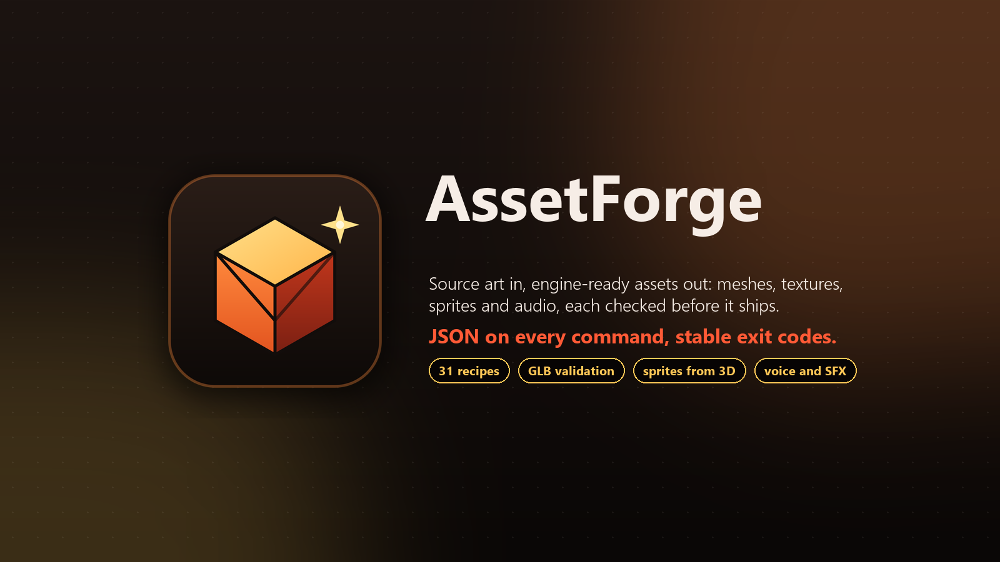
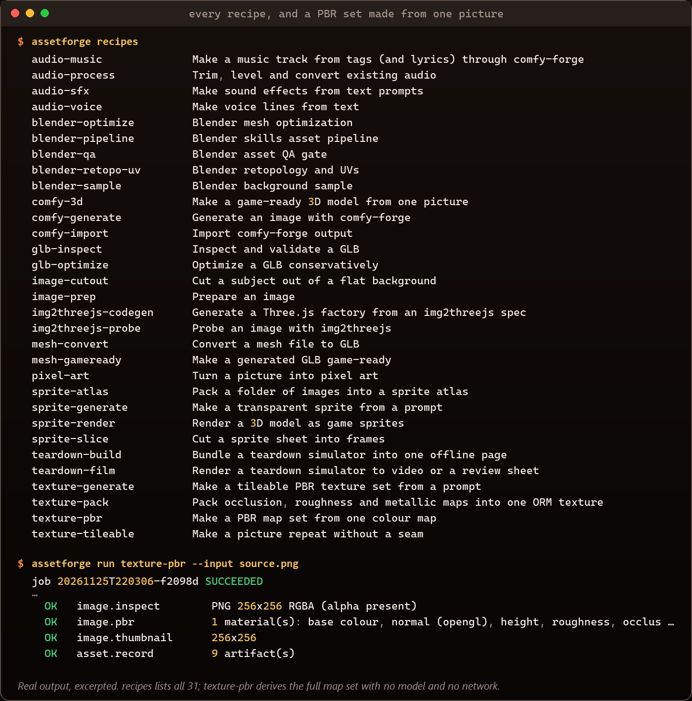
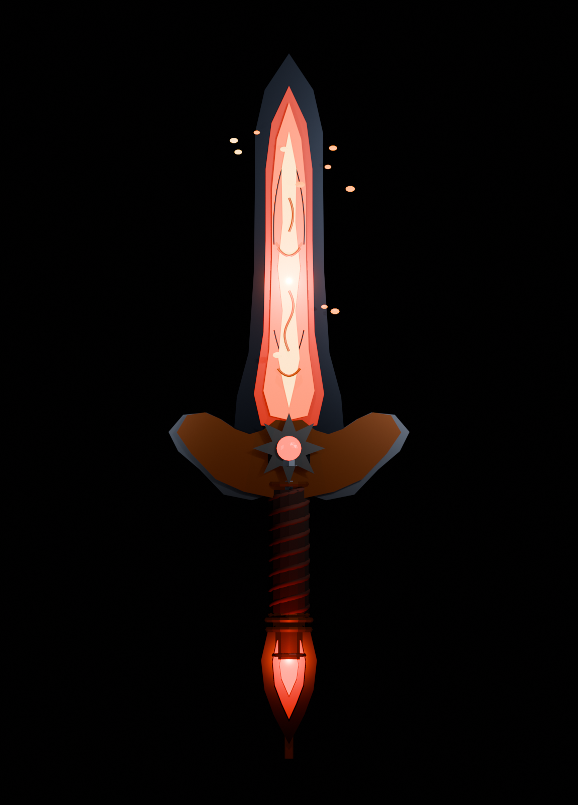

<div align="center">



[](https://github.com/SenjuWoo/AssetForge/actions/workflows/ci.yml)
[](https://github.com/SenjuWoo/AssetForge/releases)
[](pyproject.toml)
[](pyproject.toml)
[](LICENSE)

**[Install](#install)** · **[Tour](#a-short-tour)** · **[Recipes](#recipes)** · **[Commands](#commands)** · **[How it works](#how-it-works)** · **[Changelog](CHANGELOG.md)**

</div>

AssetForge is a command-line toolkit that turns source art into **validated, engine-ready game assets**: GLB meshes, PBR textures, sprites, voice lines, sound effects and music. It is built so an AI agent that can only write text and code can still ship a model, a material or a sound, and so a person can check every claim it makes. It orchestrates the tools that already do the work well (Blender, glTF-Transform, the Khronos validator, comfy-forge, img2threejs, teardown and local audio models) and owns what sits around them: one command per job, a manifest per asset, a validation report per claim and an export package per engine.

## What you get

- **Ask before you act.** `probe` reads any file or folder with no project and no writes: triangles, textures, rig, animations, which export budgets it fits, and the exact recipe command to run next.
- **Game-ready meshes, enforced.** `mesh-gameready` collapses a sculpt-density GLB in Blender under a hard triangle cap (20,000 by default) and shrinks textures, then validates the result. Over the cap is a failure, not a warning.
- **Sprites from 3D.** `sprite-render` draws a GLB at your game's camera angle in 1 to 16 facings, every animation, one shared scale, with a sheet and per-frame anchors. `pixel-art`, `image-cutout` and `sprite-slice` finish the job.
- **Materials from words or pictures.** `texture-generate` turns a prompt into a tileable PBR set through comfy-forge; `texture-tileable` and `texture-pbr` do the same to a picture you already have, with no model at all.
- **Voice, sound effects and music, checked.** Local Apache-2.0 models design and clone voices, speak nonverbals and make effects; Whisper checks the words, CLAP checks the prompt, and the best take is trimmed, levelled and encoded.
- **Honest evidence.** Structural validation, official glTF validation, export packaging and engine import are four separate claims. An export never says an engine loaded the file; `engine-check` actually launches Godot to prove it.
- **JSON everywhere.** Every command takes `--json`; exit codes are stable (`0` ok, `2` usage, `3` missing, `4` provider unavailable, `5` validation or budget failure, `6` run failure).


## Install

**Windows:** download the source zip from the [latest release](https://github.com/SenjuWoo/AssetForge/releases/latest), extract it and run `START-HERE.bat`. It creates a repo-local `.venv`, installs Pillow for the image recipes and runs `doctor`. Or from a shell:

```powershell
git clone https://github.com/SenjuWoo/AssetForge
cd AssetForge
powershell -ExecutionPolicy Bypass -File Install.ps1 -WithImages
.\assetforge.cmd doctor
```

**Linux / macOS (Python 3.10+):**

```bash
python3 -m venv .venv
source .venv/bin/activate
pip install -e ".[images]"
assetforge doctor
```

The installer writes only inside the AssetForge folder. It does not install Blender, Node packages, ComfyUI or model weights: `doctor` finds what you have and names the variable that selects anything it cannot find (`BLENDER_EXE`, `GODOT_EXE`, `FFMPEG_EXE`, `MAGICK_EXE`, `COMFY_FORGE_ROOT`, `BLENDER_SKILLS_ROOT`). A missing optional provider is a `WARNING`, and only the recipes that need it exit with code `4`.

| Optional provider | Unlocks |
|---|---|
| Blender 5.2+ | `mesh-convert`, `mesh-gameready`, `sprite-render`, the `blender-*` recipes |
| [blender-skills](https://github.com/EL4CTEO/blender-skills) | the Blender QA gate, PBR presets, export pipelines, LODs, retopology and UV packing |
| Node.js (+ glTF-Transform, Khronos validator in `.tools`) | `glb-optimize` and official glTF conformance |
| comfy-forge | `texture-generate`, `sprite-generate`, `comfy-generate`, `comfy-3d`, `audio-music` |
| Godot 4 | `engine-check` (headless import and load) |
| FFmpeg | audio finishing and measurement, `teardown-film` video |
| ImageMagick | DDS output with mipmaps |
| uv + `assetforge audio-setup` | `audio-voice` and `audio-sfx` (about 20 GB of runtimes and models) |

**Update:** `Update.ps1` fetches, refuses to run on uncommitted changes, fast-forwards only, then rebuilds `.venv` (the previous one is kept as `.venv.prev`). **Uninstall:** delete the AssetForge folder. The only thing written outside it is what you created on purpose: the audio runtimes and model cache under `~/.assetforge/audio` (or `ASSETFORGE_AUDIO_HOME`) and your own project folders.

## A short tour

```text
assetforge probe model.fbx                          # what is it, what fits, what to run next
assetforge init .                                   # once per project; every write goes under it
assetforge run mesh-convert --input model.fbx       # anything Blender reads, to one validated GLB
assetforge run mesh-gameready --input mesh=model.glb
assetforge run sprite-render --input model.glb --set directions=8 --set pitch=30
assetforge run texture-generate --set "prompt=worn oak floor planks" --set name=oak-planks
assetforge run audio-sfx --set "prompt=a steel sword swinging through the air" --set name=swing
assetforge validate ASSET --json
assetforge export ASSET --target godot --dry-run --json
assetforge engine-check model-gameready.glb          # Godot 4 imports and loads it
```

Add `--dry-run` to any `run` to see the steps and every provider it would call before anything happens. On a failure, `assetforge status --last --json` shows the failed step with the tool's own message.

Here the showcase sword goes through that loop for real: `probe` says it is over budget, `mesh-gameready` brings it under, `sprite-render` draws it.


And the assets that run produced, unretouched:


## Recipes

31 built-in recipes, all declarative JSON. The full table with every parameter is in [docs/RECIPES.md](docs/RECIPES.md); the evidence behind each one is in [docs/CAPABILITIES.md](docs/CAPABILITIES.md).

| Need | Recipe |
|---|---|
| Any mesh to one validated GLB | `mesh-convert` (FBX, OBJ, STL, PLY, glTF, USD, Alembic, `.blend`; rigs and animations kept) |
| Inspect, validate, optimize a GLB | `glb-inspect`, `glb-optimize` |
| Under a triangle budget | `mesh-gameready` (`budget=game` 20,000, `hero` 30,000, `accessory` 4,000) |
| A 3D model from a picture | `comfy-3d` |
| Sprites of a 3D model | `sprite-render` |
| A sprite from words | `sprite-generate`, then `pixel-art` for a pixel game |
| A sprite from a picture | `image-cutout`, `pixel-art`, `sprite-slice`, `sprite-atlas` |
| A material from words | `texture-generate` |
| A seamless or PBR version of a picture | `texture-tileable`, `texture-pbr`, `texture-pack` (ORM) |
| Resize, re-encode, DDS, TGA | `image-prep` |
| Voice lines, effects, music | `audio-voice`, `audio-sfx`, `audio-music`, `audio-process` |
| Blender skills pipeline and QA gate | `blender-pipeline`, `blender-qa`, `blender-optimize`, `blender-retopo-uv`, `blender-sample` |
| comfy-forge renders | `comfy-generate`, `comfy-import` |
| img2threejs and teardown | `img2threejs-probe`, `img2threejs-codegen`, `teardown-build`, `teardown-film` |



Guides: [game-ready meshes](docs/GAME-READY.md) · [textures and sprites](docs/TEXTURES-SPRITES.md) · [audio](docs/AUDIO.md).

## Commands

```text
assetforge --version
assetforge doctor [--json]
assetforge capabilities [--json]
assetforge providers [--json]
assetforge blender-skills [--route NAME] [--json]
assetforge probe PATH [--json]
assetforge init [path] [--name NAME]
assetforge recipes [list | RECIPE] [--json]
assetforge run RECIPE [--input PATH | NAME=PATH] [--set KEY=VALUE] [--asset NAME] [--dry-run] [--json]
assetforge status [JOB_ID | --last] [--json]
assetforge inspect ASSET [--json]
assetforge validate ASSET [--json]
assetforge export ASSET --target roblox|godot|generic|minecraft [--namespace NS] [--dry-run] [--json]
assetforge audio-setup [speech|sfx|kokoro ...] [--list] [--device auto|cuda|cpu] [--json]
assetforge engine-check FILE.glb [--engine godot] [--timeout S] [--json]
```

On Windows without an activated environment, call `assetforge.cmd` from the AssetForge folder. `--set` values are typed by the recipe: a boolean takes `true/false`, `yes/no`, `on/off` or `1/0`, and anything else (such as `ture`) is a usage error, not `false`.

## How it works

```text
project/
  assetforge.json
  assets/<asset-id>/
    asset.json          manifest: inputs, artifacts, provenance, validation
    inputs/             copies of the sources; a source file is never modified
    outputs/  previews/  exports/
  .assetforge/jobs/<job-id>/
    job.json  run.log   per-step status, errors and tool versions
```

- **Recipes are data.** A recipe can only name implemented step kinds; it cannot run a shell string or an arbitrary script. External tools are called with argument lists, explicit working directories and timeouts.
- **Paths stay inside the project.** Artifact paths are project-relative and rejected if absolute, missing or escaping the project (`..` and symlinks included).
- **Evidence is tiered.** `VERIFIED`, `WARNING`, `NOT_TESTED` and `FAIL` are kept apart, and a `NOT_TESTED` check is never reported as passed. Generated pictures and sounds carry `GEN-VISUAL` / `AUDIO-LISTEN` `NOT_TESTED` until a person looks or listens.
- **Nothing leaves the machine.** AssetForge never uploads to Roblox, Godot or any account and stores no credentials. Audio models run locally; their weights download from Hugging Face on first use.

Architecture: [docs/ARCHITECTURE.md](docs/ARCHITECTURE.md). Capability status, providers, the recommended Blender (blender-skills) and comfy-forge workflows, and the security boundaries: [docs/CAPABILITIES.md](docs/CAPABILITIES.md).

## Showcase



A stylized prop built directly in Blender: `examples/assets/enchanted-fire-sword.glb`, with a reproducible generator (`examples/generate-enchanted-fire-sword.py`) for the faceted blade shell, ember layers, raised runes and scrollwork, bat-wing crossguard, wrapped hilt, finial and floating sparks. As shipped it is 21,856 triangles, just over the 20,000 game cap, so `probe` sends it to `mesh-gameready` first; after that it fits every export budget, Roblox included. Roblox Studio import was not run, so engine integration there stays `NOT_TESTED`. The concept exploration was generated locally through comfy-forge; the GLB itself is project-owned procedural geometry.

## Ultimate AI Starter Bundle

AssetForge stands alone. It can also be registered as a companion of the Ultimate AI Starter Bundle, which then routes asset work to it; AssetForge keeps ownership of its installation, updates, diagnostics and releases, and no bundle files are modified by this repository. Contract: [docs/UABS-INTEGRATION.md](docs/UABS-INTEGRATION.md) and `integration/COMPANIONS.asset-forge.json`.

## Documentation

- [Capabilities, providers and workflows](docs/CAPABILITIES.md) · [Architecture](docs/ARCHITECTURE.md) · [Providers](docs/PROVIDERS.md) · [Recipes](docs/RECIPES.md)
- [Game-ready meshes](docs/GAME-READY.md) · [Textures and sprites](docs/TEXTURES-SPRITES.md) · [Audio](docs/AUDIO.md)
- [Upstream evaluations](docs/UPSTREAM-EVALUATIONS.md) · [Bundle integration](docs/UABS-INTEGRATION.md) · [Third-party notices](docs/THIRD-PARTY-NOTICES.md)
- [Changelog](CHANGELOG.md) · [Roadmap](ROADMAP.md) · [Plan](PLAN.md) · [State](STATE.md) · [Validation evidence](VALIDATION.md) · [Release checklist](RELEASE.md)

## License

MIT. See [LICENSE](LICENSE).
